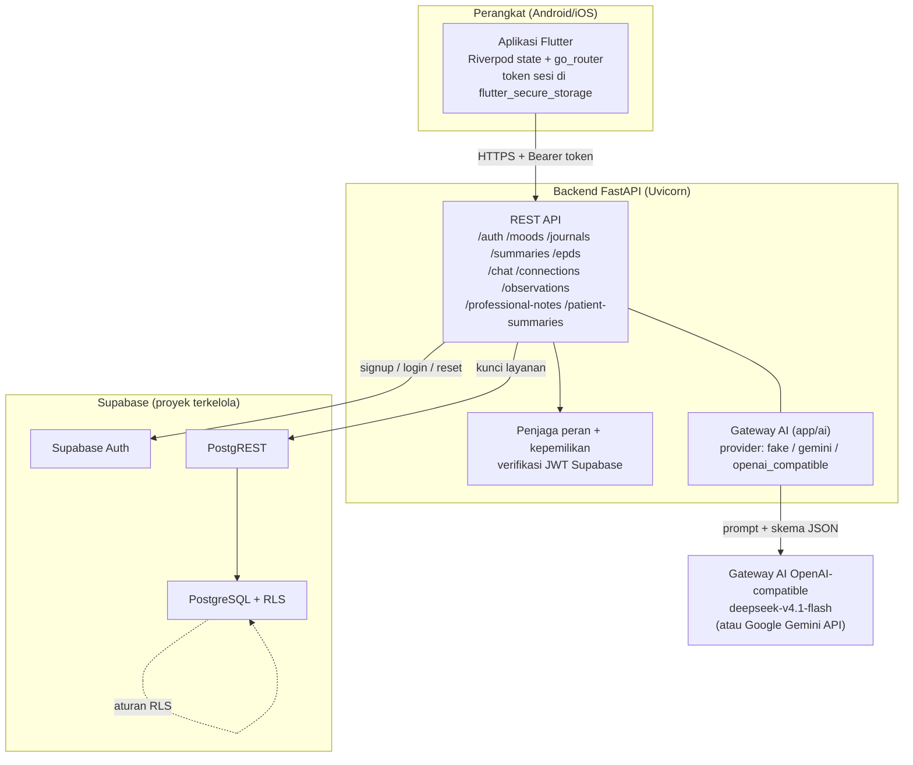

# Dampingi

Aplikasi mobile pendamping kesehatan mental ibu pascapersalinan. Ibu mencatat
mood dan jurnal harian, mendapat ringkasan mingguan, skrining EPDS berkala, dan
asisten tanya-jawab; pendamping serta tenaga profesional (bidan/psikolog)
memantau kondisi ibu lewat observasi dan catatan yang dibagikan secara
eksplisit oleh ibu.

## 1. Tim

| | |
|---|---|
| Nama tim | _isi_ |

| No | Nama anggota | Peran di tim | Akun GitHub |
|---|---|---|---|
| 1 | _isi_ | _isi_ | _isi_ |
| 2 | _isi_ | _isi_ | _isi_ |
| 3 | _isi_ | _isi_ | _isi_ |

Repositori: <https://github.com/pratamabintang/dampingi-app-logicodix>

## 2. Identitas Produk

| | |
|---|---|
| Kategori | **Mobile** (aplikasi Android/iOS, Flutter) |
| Nama aplikasi | **Dampingi** |
| Versi | `1.0.0+1` (`mobile/pubspec.yaml`) |

**Deskripsi solusi.** Dampingi menyatukan tiga hal yang biasanya terpisah:
pencatatan mandiri ibu (mood, jurnal, kalender harian), dukungan orang terdekat
(observasi harian pendamping), dan pemantauan tenaga profesional — di atas satu
backend yang menegakkan aturan otorisasi per peran. Semua data sensitif dibatasi
oleh Row Level Security di database, dan ibu memegang kendali penuh atas
hubungan serta izin berbagi datanya. Sebagai lapisan pendukung, aplikasi
menyediakan asisten tanya-jawab berbasis AI dan ringkasan mingguan otomatis, bukan
diagnosis.

**Masalah yang diangkat.**

- Deteksi dini depresi pascapersalinan sering terlewat karena skrining tidak
  rutin dan pencatatan suasana hati tidak konsisten.
- Catatan ibu terpencar (kertas, pesan pribadi, ingatan) sehingga sulit dilihat
  sebagai pola oleh orang yang mendampingi.
- Pendamping dan tenaga profesional tidak punya gambaran harian yang ringkas;
  saat punya pun, sering kali ibu tidak tahu data apa yang dibagikan.
- Keluhan ibu sering ditanggapi terlalu cepat sebagai diagnosis, padahal butuh
  pengarahan ke layanan yang tepat.

**Target pengguna.**

| Peran | Kebutuhan utama |
|---|---|
| **Ibu** (ibu pascapersalinan, pengguna utama) | Mencatat mood dan jurnal harian, melihat kalender dan ringkasan mingguan, skrining EPDS, berkonsultasi lewat chat, mengatur koneksi dan izin berbagi |
| **Pendamping** (pasangan/keluarga) | Mengisi observasi harian tentang kondisi ibu, melihat riwayatnya, melihat kondisi umum ibu |
| **Tenaga profesional** (bidan/psikolog) | Melihat daftar pasien yang terhubung, membaca cerita harian dan ringkasan pasien, menulis catatan profesional |

## 3. Fitur Utama yang Sudah Diimplementasikan

**Masuk & peran**

- Registrasi, verifikasi email, masuk, segarkan sesi dengan rotasi refresh token
  (ADR-0018), lupa kata sandi tiga langkah (email → kode → kata sandi baru),
  ganti kata sandi, keluar, dan hapus akun (soft delete + tombstone, ADR-0003).
- Pemilihan peran (ibu / pendamping / tenaga profesional) yang menentukan rute
  yang boleh dibuka; peran juga diverifikasi ulang di backend.

**Sisi ibu**

- Catatan mood harian pada skala 1–5 beserta catatan teks opsional, dibatasi
  satu catatan per hari menurut zona waktu pengguna (ADR-0010).
- Jurnal harian (tulis, ubah, hapus, lihat) dengan tanggal memakai hari lokal
  penulis (ADR-0007).
- Kalender riwayat: menandai hari yang punya mood, lalu membuka cerita harian
  hari tersebut.
- Ringkasan mingguan otomatis (mood + tema jurnal) dan ringkasan harian.
- Skrining **EPDS** sepuluh soal dengan penjadwalan berkala: pengisian pertama
  7 hari setelah pendaftaran, pengisian berikutnya 7 hari setelah pengisian
  terakhir; permintaan yang terlalu cepat ditolak di backend dan di database.
- Peringatan/kartu tanda bahaya dan notifikasi catatan profesional yang
  dibagikan, serta sesi meditasi (daftar + sesi pernapasan).
- Chat asisten "Teman Dampingi" dengan riwayat percakapan.
- Profil, ubah profil, dan pengaturan koneksi serta izin berbagi data.

**Sisi pendamping**

- Observasi harian ibu: sepuluh pertanyaan dengan pilihan ganda spesifik per
  soal, satu pertanyaan per layar dialog, jawaban dikirim sekaligus di akhir;
  satu observasi selesai per hubungan per hari.
- Riwayat observasi dan kondisi umum ibu yang terhubung.
- Profil, ubah profil, dan pengelolaan koneksi (kode undangan).

**Sisi tenaga profesional**

- Daftar pasien (kasus multi-pasien) dan pemilihan pasien.
- Cerita harian pasien, ringkasan pasien, dan halaman panduan.
- Catatan profesional per hubungan (tulis, lihat, ubah, hapus lunak
  ADR-0014) dengan notifikasi ke ibu bila dibagikan.
- Izin berbagi per hubungan yang dikendalikan ibu.

**Lintas peran**

- **Koneksi lewat kode undangan** (ADR-0017): ibu membuat kode berlaku terbatas
  untuk peran tujuan, pihak lain menebusnya menjadi hubungan; kode dapat
  dicabut, dan hubungan dapat diakhiri. Satu pendamping dan satu profesional
  aktif per ibu.
- **Mode pratinjau** tanpa backend: aplikasi bisa dijalankan dan ditelusuri
  tanpa server (autentikasi tiruan, data fixture).

**Backend**

- REST API FastAPI berperan sebagai satu-satunya pintu data; klien mobile tidak
  pernah menulis langsung ke database dan tidak pernah memanggil AI langsung.
- Otorisasi dua lapis: pemeriksaan peran/ kepemilikan di backend, ditambah RLS
  di database (ADR-0016).
- Pembatasan daftar 1–31 item per permintaan (ADR-0015) dan pembatasan kuota
  chat.

## 4. Teknologi yang Digunakan

**Mobile** (`mobile/`, Dart SDK `^3.13.7`, Flutter)

| Paket | Kegunaan | Sumber | Lisensi |
|---|---|---|---|
| Flutter / Dart | Kerangka aplikasi | <https://github.com/flutter/flutter> | BSD-3-Clause |
| `flutter_riverpod` `^3.5.0` | Manajemen state & injeksi dependensi | <https://pub.dev/packages/flutter_riverpod> | MIT |
| `go_router` `^18.1.4` | Navigasi deklaratif & penjaga rute per peran | <https://pub.dev/packages/go_router> | BSD-3-Clause |
| `flutter_svg` `^2.2.3` | Render aset SVG | <https://pub.dev/packages/flutter_svg> | MIT |
| `flutter_secure_storage` `^11.2.0` | Simpan token sesi di penyimpanan aman perangkat | <https://pub.dev/packages/flutter_secure_storage> | BSD-3-Clause |
| `flutter_lints` `^6.0.0` | Aturan lint | <https://pub.dev/packages/flutter_lints> | BSD-3-Clause |

Dependensi transitif ikut lisensi masing-masing paket; berkas `NOTICES` yang
dihasilkan Flutter di perangkat berisi teks lisensi lengkap.

**Backend** (`backend/`, Python)

| Paket | Kegunaan | Sumber | Lisensi |
|---|---|---|---|
| FastAPI | Kerangka REST API | <https://pypi.org/project/fastapi/> | MIT |
| Uvicorn | Server ASGI | <https://pypi.org/project/uvicorn/> | BSD-3-Clause |
| pydantic, pydantic-settings | Validasi & pembacaan konfigurasi | <https://pypi.org/project/pydantic/> | MIT |
| httpx | Klien HTTP ke Supabase & gateway AI | <https://pypi.org/project/httpx/> | BSD-3-Clause |
| PyJWT[crypto] | Verifikasi token sesi | <https://pypi.org/project/PyJWT/> | MIT |
| google-genai | SDK Gemini (opsi provider AI) | <https://pypi.org/project/google-genai/> | Apache-2.0 |
| jsonschema | Validasi skema keluaran AI | <https://pypi.org/project/jsonschema/> | MIT |
| email-validator | Validasi alamat email | <https://pypi.org/project/email-validator/> | Unlicense |
| tzdata | Basis data zona waktu | <https://pypi.org/project/tzdata/> | Apache-2.0 |
| pytest | Kerangka uji | <https://pypi.org/project/pytest/> | MIT |

**Database & infrastruktur**

| | |
|---|---|
| Database | PostgreSQL lewat **Supabase** (proyek terkelola) |
| Autentikasi | **Supabase Auth** (email + kata sandi, verifikasi email, kode reset) |
| Otorisasi data | **Supabase Row Level Security** (`supabase/migrations/20261110120007_rls_and_grants.sql`) + pemeriksaan di backend |
| Akses data | PostgREST (REST Supabase) dari backend; tidak ada koneksi SQL langsung dari aplikasi |
| Skema & migrasi | SQL berversi di `supabase/migrations/` (20 berkas); lokal lewat `supabase db reset`, proyek terkelola lewat SQL editor / Management API |
| Penyimpanan lokal (dev) | Docker + Supabase CLI (`supabase/config.toml`, port lokal 54321/54322) |
| Kontrol versi | Git + GitHub |
| Deployment | Layanan apa pun yang menjalankan Uvicorn; konfigurasi default mengizinkan `*.onrender.com` (Render) dalam `TRUSTED_HOSTS`. Selama pengujian demo dipakai VPS + Cloudflare Tunnel |

**API & layanan pihak ketiga**

| Layanan | Dipakai untuk | Sumber |
|---|---|---|
| Supabase (Auth, Postgres, PostgREST, RLS) | Autentikasi, penyimpanan seluruh data, penegakan akses | <https://supabase.com> |
| Gateway AI OpenAI-compatible | Asisten chat & ringkasan (provider aktif) | base `https://nutaraline.co.uk/v1`, model `deepseek-v4.1-flash` |
| Google Gemini API | Alternatif provider AI (`AI_PROVIDER=gemini`) | <https://ai.google.dev> |
| Cloudflare Tunnel (cloudflared) | Menyediakan HTTPS untuk backend demo saat pengujian di perangkat | <https://developers.cloudflare.com/cloudflare-one/connections/connect-networks/> |
| Render | Opsi hosting backend | <https://render.com> |
| Figma | Perancangan UI/UX (desain milik tim) | <https://www.figma.com> |
| GitHub | Repositori & kolaborasi | <https://github.com> |

## 5. Arsitektur Sistem dan Alur Data



**Alur data utama.** Aplikasi mobile hanya bicara dengan backend. Backend
memverifikasi token sesi ke Supabase Auth, memeriksa peran serta kepemilikan
sumber daya, lalu menulis/membaca lewat PostgREST memakai kunci layanan — RLS
di database berlaku sebagai lapisan kedua. Pemanggilan AI dilakukan backend,
selalu dengan skema JSON yang divalidasi ulang sebelum sampai ke pengguna.

```mermaid
sequenceDiagram
  participant U as Ibu atau Pendamping
  participant B as Backend FastAPI
  participant S as Supabase (Auth + Postgres)
  participant A as Gateway AI

  U->>B: POST /auth/login (email, kata sandi)
  B->>S: Supabase Auth
  S-->>B: access token + refresh token
  B-->>U: token sesi (disimpan di secure storage)

  U->>B: POST /moods (skala, catatan) + Bearer token
  B->>B: verifikasi token, peran, hari lokal, batas 1 catatan/hari
  B->>S: PostgREST (kunci layanan) → moods
  S-->>B: baris tersimpan
  B-->>U: 201 Created

  U->>B: POST /chat (pesan)
  B->>B: susun konteks dalam batas (riwayat ≤10 pesan, mood ≤7 entri)
  B->>A: prompt + skema {reply, urgent}
  A-->>B: JSON jawaban
  B->>B: validasi Pydantic; tolak bila tidak sesuai
  B->>S: simpan sesi & pesan
  B-->>U: balasan + context_used
```

**Batas tepercaya.** Kunci Supabase (secret) dan kunci AI hanya ada di server
(`backend/.env`). Aplikasi mobile tidak menyimpan kredensial layanan apa pun;
mode autentikasi backend diaktifkan saat build lewat `--dart-define`.

## 6. Instalasi, Konfigurasi, dan Menjalankan Aplikasi

### 6.1 Prasyarat

| Alat | Versi |
|---|---|
| Flutter SDK | stabil, Dart `^3.13.7` |
| Python | 3.11+ |
| Docker | untuk Supabase lokal (`supabase start`) |
| Supabase CLI | untuk `supabase start` / `supabase db reset` |
| Git | — |

### 6.2 Variabel lingkungan

Semua kredensial **hanya** lewat environment variable dan file `.env`. Tidak ada
kunci, token, atau kata sandi yang ditulis di kode. `.env` sudah masuk
`.gitignore` (`.env`, `.env.local`, `*.env`) sehingga tidak ikut ter-push; yang
dikomit hanya `.env.example` tanpa nilai asli.

**Backend — `backend/.env.example`** (salin menjadi `backend/.env` lalu isi):

| Variabel | Wajib | Kegunaan |
|---|---|---|
| `APP_ENV` | ya | `development` atau `production`. Di luar `development`, `/docs` dan `/redoc` dimatikan |
| `PORT` | tidak (default `8000`) | Port Uvicorn |
| `SUPABASE_URL` | ya | URL proyek Supabase |
| `SUPABASE_PUBLISHABLE_KEY` | ya | Kunci publik Supabase (dipakai untuk autentikasi pengguna) |
| `SUPABASE_SECRET_KEY` | ya | Kunci layanan Supabase; **rahasia**, hanya di server |
| `GEMINI_API_KEY` | hanya untuk `AI_PROVIDER=gemini` | Kunci API Google Gemini |
| `GEMINI_MODEL` | hanya untuk `AI_PROVIDER=gemini` | Nama model Gemini, mis. `gemini-3.1-flash-lite` |
| `AI_PROVIDER` | ya (default `fake`) | `fake` (tanpa biaya), `gemini`, atau `openai_compatible` |
| `AI_API_KEY` | hanya untuk `openai_compatible` | Kunci gateway AI |
| `AI_BASE_URL` | hanya untuk `openai_compatible` | Base URL gateway, mis. `https://host/v1` |
| `AI_MODEL` | hanya untuk `openai_compatible` | Nama model, mis. `deepseek-v4.1-flash` |
| `AI_TIMEOUT_SECONDS` | tidak (default `20`) | Batas waktu panggilan AI |
| `TRUSTED_HOSTS` | tidak | Daftar host diizinkan, dipisah koma |

**Uji backend — `backend/tests/.env.example`** (salin menjadi `backend/tests/.env`):
`SUPABASE_URL`, `SUPABASE_PUBLISHABLE_KEY`, `SUPABASE_SECRET_KEY`.

**Mobile — tanpa file `.env`.** Aplikasi mobile tidak menyimpan kredensial;
konfigurasi diberikan saat build lewat `--dart-define`:

| Define | Nilai | Kegunaan |
|---|---|---|
| `API_BASE_URL` | alamat backend, mis. `https://contoh.trycloudflare.com` | Alamat API. Bila kosong, aplikasi berjalan di mode pratinjau |
| `USE_BACKEND_AUTH` | `true` / `false` (default `false`) | `true` untuk autentikasi ke backend sungguhan |

### 6.3 Menjalankan backend

```sh
cd backend
python -m venv .venv
# Windows: .venv\Scripts\activate
source .venv/bin/activate
pip install -r requirements.txt

cp .env.example .env        # lalu isi SUPABASE_URL, kunci Supabase, dan AI
uvicorn app.main:app --reload --port 8000
```

Pemeriksaan cepat: `GET http://127.0.0.1:8000/health` → `{"status":"healthy"}`.
Dokumentasi interaktif tersedia di `/docs` saat `APP_ENV=development`.

Uji tanpa memanggil layanan luar:

```sh
cd backend
pytest -m local          # memakai AI_PROVIDER=fake, tidak menghubungi AI
```

### 6.4 Menyiapkan database

**Lokal (disarankan untuk pengembangan):**

```sh
supabase start
supabase db reset        # menerapkan seluruh migrasi di supabase/migrations/
cd backend && python -m app.seed
```

**Proyek Supabase terkelola:** jalankan berkas di `supabase/migrations/`
berurutan (SQL editor dashboard, atau Management API `POST
/v1/projects/{ref}/database/query` dengan isi berkas). Migrasi bersifat
incremental dan idempoten; tidak ada langkah otomatis di deployment, jadi
migrasi baru harus dijalankan sendiri.

Seed membuat akun uji beserta data contohnya (mood, jurnal, koneksi, kode
undangan, observasi, catatan profesional) lewat jalur pendaftaran asli sehingga
trigger auth dan validasi peran ikut teruji.

### 6.5 Menjalankan aplikasi mobile

```sh
cd mobile
flutter pub get
flutter run --dart-define=API_BASE_URL=http://10.0.2.2:8000 --dart-define=USE_BACKEND_AUTH=true
```

- `10.0.2.2` adalah localhost mesin host dari emulator Android; pakai alamat
  LAN atau URL tunnel bila diuji di perangkat fisik.
- Tanpa `API_BASE_URL`, aplikasi berjalan di **mode pratinjau** dengan
  autentikasi tiruan dan data fixture, tanpa backend.
- Build APK: `flutter build apk --debug` (tambahkan kedua `--dart-define` di atas).
- Uji: `flutter test` dan `flutter analyze`.

### 6.6 Konfigurasi tambahan per fitur

| Fitur | Konfigurasi tambahan |
|---|---|
| Chat asisten & ringkasan mingguan | `AI_PROVIDER` bukan `fake`, ditambah `AI_API_KEY` + `AI_BASE_URL` + `AI_MODEL` (atau `GEMINI_API_KEY` + `GEMINI_MODEL`) dan `AI_TIMEOUT_SECONDS` |
| Verifikasi email & reset kata sandi | SMTP/konfigurasi email di proyek Supabase; template memakai kode (`{{ .Token }}`) dan masa berlaku kode diatur di dashboard Supabase |
| Koneksi & kode undangan | Migrasi `20261110120002_connections.sql` (kode format `XXXX-XXXX` berlaku 1 jam, satu kode hidup per nilai, satu pendamping + satu profesional aktif per ibu) |
| Observasi pendamping | Migrasi `20261110120004` / `20261110120005`; satu observasi selesai per hubungan per hari |
| Skrining EPDS berkala | Migrasi `20261114000001_epds_assessments_and_alerts.sql` dan `20261115000001_weekly_epds_guard.sql` (trigger penjadwal 168 jam) |
| Ringkasan mingguan & harian | Migrasi `20261114000002_weekly_summaries.sql`, `20261114000003_daily_summaries.sql` |
| Izin berbagi data pasien | Migrasi `20261114000003_professional_sharing_permissions.sql` |
| Akses backend dari perangkat fisik | Host/domain backend harus ada di `TRUSTED_HOSTS`, atau dipakai tunnel HTTPS |

## 7. Akun Demonstrasi

Autentikasi memakai Supabase Auth, jadi akun demonstrasi disediakan lewat seed
(`python -m app.seed`). Kata sandi semua akun seed sama.

| Peran | Email | Kata sandi |
|---|---|---|
| Ibu | `seed.mother@gmail.com` | `Seed!123` |
| Pendamping | `seed.companion@gmail.com` | `Seed!123` |
| Tenaga profesional | `seed.professional@gmail.com` | `Seed!123` |

Akun tambahan yang dibuat seed untuk menguji kasus multi-pasien:
`seed.mother2@gmail.com`, `seed.professional2@gmail.com` (kata sandi sama), dan
`seed.deleted.mother@gmail.com` (akun sengaja di-soft-delete untuk menguji jalur
identitas yang dinonaktifkan).

Mode pratinjau (tanpa backend) memakai akun tiruan yang didefinisikan di
`mobile/lib/features/auth/repositories/mock_auth_repository.dart`.

## 8. Dokumentasi Penggunaan AI

### 8.1 Layanan/model yang dipakai dan bagian produk yang memanfaatkannya

| Fitur produk | Layanan / model | Kode | Data yang dikirim ke AI |
|---|---|---|---|
| **Teman Dampingi** — chat pendamping untuk ibu dan pendamping | Gateway OpenAI-compatible: base `https://nutaraline.co.uk/v1`, model `deepseek-v4.1-flash` | `backend/app/ai/`, `backend/app/chat/` | Pesan pengguna; maksimal 10 pesan riwayat (≤ 6.000 karakter) dari percakapan yang sama; khusus ibu, maksimal 7 entri mood terakhir **miliknya sendiri** (tanggal + skala 1–5 saja) |
| **Ringkasan mingguan** | Gateway yang sama (`AI_MODEL`) | `backend/app/summaries/`, `backend/app/journals/extraction.py` | Tanggal dan skala mood ibu serta tema jurnal hasil ekstraksi. Konten mentah jurnal tidak diteruskan ke AI pembuat ringkasan |
| **Ekstraksi tema jurnal** | Gateway yang sama | `backend/app/journals/extraction.py` | Isi jurnal ibu, hanya untuk menghasilkan tema; hasilnya dipakai ringkasan, isi mentahnya tidak |

Backend mendukung tiga provider, dipilih lewat `AI_PROVIDER`
(`backend/app/ai/config.py`):

| Provider | Model/layanan | Keterangan |
|---|---|---|
| `openai_compatible` | Gateway pihak ketiga yang protokolnya OpenAI; pada demo: `deepseek-v4.1-flash` di `https://nutaraline.co.uk/v1` | **Dipakai saat ini.** Butuh `AI_API_KEY`, `AI_BASE_URL`, `AI_MODEL` |
| `gemini` | Google Gemini API, model dari `GEMINI_MODEL` (default `gemini-3.1-flash-lite`), SDK `google-genai` | Alternatif; butuh `GEMINI_API_KEY` |
| `fake` | Jawaban tetap, tanpa jaringan | **Default.** Dipakai seluruh uji `pytest -m local` |

Kunci API hanya ada di server (`backend/.env`). Aplikasi mobile tidak pernah
memanggil AI langsung dan tidak menyimpan kunci AI.

### 8.2 Pengaman pada chatbot

- **Bukan diagnosis.** Instruksi sistem melarang diagnosis serta nama/dosis obat,
  dan mengarahkan keluhan medis ke bidan, dokter, atau puskesmas
  (`backend/app/chat/prompts.py`).
- **Tanda bahaya.** AI wajib mengisi `urgent: true` bila ada tanda bahaya
  (pikiran menyakiti diri/bayi, perdarahan hebat, dll.). Aplikasi lalu
  menampilkan kontak darurat (119 / IGD terdekat).
- **Jawaban terstruktur dan diperiksa.** AI diminta menjawab dengan skema JSON
  `{reply, urgent}`; backend memeriksa ulang dengan Pydantic. Jawaban yang tidak
  sesuai tidak pernah sampai ke pengguna.
- **Gagal dengan aman.** Bila AI lambat (> 20 dtk) atau error, pengguna menerima
  pesan ramah (503) dan **tidak ada yang tersimpan**, sehingga bisa langsung
  kirim ulang.
- **Batas pemakaian.** Maksimal 50 pesan per pengguna per 24 jam
  (`CHAT_DAILY_LIMIT`) dan satu pesan dalam proses per pengguna (429).
- **Transparansi.** Setiap jawaban membawa `context_used` (mis. `["mood_7d"]`)
  sehingga aplikasi bisa memberi tahu ibu data apa yang ikut dipakai.

### 8.3 Data dan privasi

- **Jurnal tidak dikirim ke chatbot.** Untuk ringkasan mingguan, isi jurnal ibu
  diproses AI khusus untuk mengekstrak tema; konten mentah tidak diteruskan ke
  AI pembuat ringkasan.
- Catatan teks pada mood (`description`) tidak dikirim ke AI.
- Ringkasan mingguan hanya menggunakan data milik ibu yang terautentikasi.
- Pendamping tidak mendapat data jurnal pribadi ibu tanpa persetujuan eksplisit.
- Riwayat chat disimpan di Supabase (`chat_sessions`, `chat_messages`) dengan RLS
  aktif; hanya backend yang mengaksesnya, dan setiap query difilter per pemilik.
- **Akun dan isi demo bersifat fiktif.** Data yang dipakai saat demonstrasi
  bukan data ibu sungguhan. Ketentuan pemakaian data gateway AI pihak ketiga
  mengikuti kebijakan penyedianya; jangan mengirim data pasien sungguhan tanpa
  dasar kewenangan dan persetujuan.

### 8.4 Cara mencoba dengan AI sungguhan

1. Isi `backend/.env`, salah satu:
   - `AI_PROVIDER=openai_compatible` + `AI_API_KEY` + `AI_BASE_URL` + `AI_MODEL`; atau
   - `AI_PROVIDER=gemini` + `GEMINI_API_KEY` + `GEMINI_MODEL`.
2. Dari folder `backend`: `python scripts/ai_smoke.py` (skenario fiktif: biasa,
   memakai mood, tanda bahaya, pendamping, prompt injection).

Tanpa kunci, `AI_PROVIDER=fake` (default) memberi jawaban tetap tanpa biaya.

### 8.5 AI dalam proses pengembangan

Tim memakai **Claude Code** (Anthropic) sebagai AI coding assistant untuk
membantu menulis, menjelaskan, dan meninjau kode. Seluruh kode ditinjau, diuji,
dan dipahami oleh anggota tim; keputusan desain tetap di tangan tim.

## 9. Keamanan dan Penanganan Kredensial

- Tidak ada API key, token, kata sandi database, atau kredensial lain yang
  ditulis langsung (hardcoded) di repositori.
- Kredensial disimpan sebagai environment variable di file `.env`
  (`backend/.env`, `backend/tests/.env`).
- `.env` masuk `.gitignore` (`.env`, `.env.local`, `.env.*.local`, `*.env`) dan
  tidak pernah di-push.
- Tim menyediakan `backend/.env.example` dan `backend/tests/.env.example` berisi
  nama variabel tanpa nilai asli.
- Kunci layanan (`SUPABASE_SECRET_KEY`, `AI_API_KEY`, `GEMINI_API_KEY`) hanya
  berada di server; aplikasi mobile tidak menyimpan kredensial dan hanya
  menerima alamat backend lewat `--dart-define`.
- Bila kredensial pernah bocor (mis. ter-push), segera rotasi di penyedia dan
  hapus dari riwayat repositori.

## 10. API Ringkasan Mingguan

**Endpoint**

`POST /summaries/weekly`

**Request Body**

| Field | Type | Description |
|---|---|---|
| `period_start` | `date` | Tanggal awal periode. Harus hari Senin. |

**Response**

| Field | Type | Description |
|---|---|---|
| `period_start` | `date` | Tanggal awal periode. |
| `period_end` | `date` | Tanggal akhir periode, yaitu enam hari setelah `period_start`. |
| `audience` | `string` | Penerima ringkasan, saat ini `mother`. |
| `status` | `string` | Status pemrosesan ringkasan. |
| `overview` | `string` atau `null` | Ringkasan mingguan yang dihasilkan AI. |
| `limitations` | `array[string]` | Keterbatasan atau data yang tidak tersedia selama periode tersebut. |
| `source_refs` | `array` | Referensi ID sumber data yang digunakan dalam ringkasan. |
| `prompt_version` | `string` | Versi prompt AI yang digunakan. |

**Contoh Request**

```json
{
  "period_start": "2026-11-09"
}
```

**Contoh Response**

```json
{
  "period_start": "2026-11-09",
  "period_end": "2026-11-15",
  "audience": "mother",
  "status": "completed",
  "overview": "Ringkasan kondisi ibu selama satu minggu.",
  "limitations": [
    "Catatan mood tersedia pada 3 dari 7 hari."
  ],
  "source_refs": [
    {
      "source_type": "mother_mood",
      "source_id": "mood-1"
    }
  ],
  "prompt_version": "weekly-summary-v2"
}
```

**Catatan**

- Periode ringkasan selalu tujuh hari dan harus dimulai pada hari Senin.
- Ringkasan dapat menggunakan data mood dan tema jurnal yang berhasil diekstrak.
- Konten mentah jurnal tidak diteruskan ke AI pembuat ringkasan.
- Ringkasan bersifat informatif dan bukan diagnosis klinis.
- Evaluasi klinis EPDS belum diaktifkan sebagai dasar diagnosis.

Dokumentasi endpoint lain ada di `docs/api/` (auth, chat, gateway AI) dan
deskripsi OpenAPI otomatis di `/docs` saat mode pengembangan.

## 11. Atribusi Pihak Ketiga

**Kode dan library.** Aplikasi mobile memakai paket-paket Flutter/Dart dan
backend memakai paket-paket Python yang dicantumkan pada bagian 4 beserta
sumber dan lisensinya. Seluruhnya dipakai sebagai dependensi tanpa perubahan
sumber; tidak ada kode pihak ketiga yang disalin ke dalam repositori. Teks
lisensi lengkap tersedia pada `NOTICES` hasil build Flutter dan pada halaman
paket masing-masing.

**Template dan desain.** Template UI/UX dirancang sendiri oleh tim di Figma;
tidak memakai template antarmuka atau tema pihak ketiga. Komponen visual dibangun
dengan widget bawaan Flutter (`Material`).

**Aset.** Gambar, ilustrasi, dan ikon di `mobile/assets/images/` dibuat oleh tim
(diekspor dari rancangan Figma tim) — bukan aset dari sumber pihak ketiga.
Font **Mona Sans** (`mobile/assets/fonts/mona_sans/`) berasal dari GitHub
(<https://github.com/github/mona-sans>), lisensi **SIL Open Font License 1.1**.
Ikon bawaan aplikasi memakai **Material Icons** milik Flutter, lisensi
BSD-3-Clause.

**Dataset dan instrumen.**

- Data contoh di `mobile/assets/fixtures/mother-stories.json` dan
  `mobile/assets/fixtures/profiles-select-2026-11-09.json` adalah data fiktif
  buatan tim untuk pratinjau, bukan hasil pengumpulan data nyata.
- Data seed di `backend/app/seed.py` juga data fiktif.
- **Edinburgh Postnatal Depression Scale (EPDS)**: Cox, J. L., Holden, J. M., &
  Sagovsky, R. (1987). Detection of postnatal depression: Development of the
  10-item Edinburgh Postnatal Depression Scale. *British Journal of Psychiatry,
  150*, 782–786. Instrumen EPDS di aplikasi dipakai sebagai alat skrining, bukan
  diagnosis. Terjemahan bahasa Indonesia di aplikasi dibuat tim untuk demo dan
  **belum divalidasi** secara linguistik maupun klinis; penggunaannya di luar
  demo memerlukan validasi dan izin yang sesuai dari pemegang hak.

**Layanan.** Layanan pihak ketiga yang dipakai beserta bagian produk yang
memanfaatkannya tercantum pada bagian 4 (Supabase, gateway AI
OpenAI-compatible, Google Gemini API, Cloudflare Tunnel, Render, Figma, GitHub)
dan bagian 8 (penggunaan AI).
